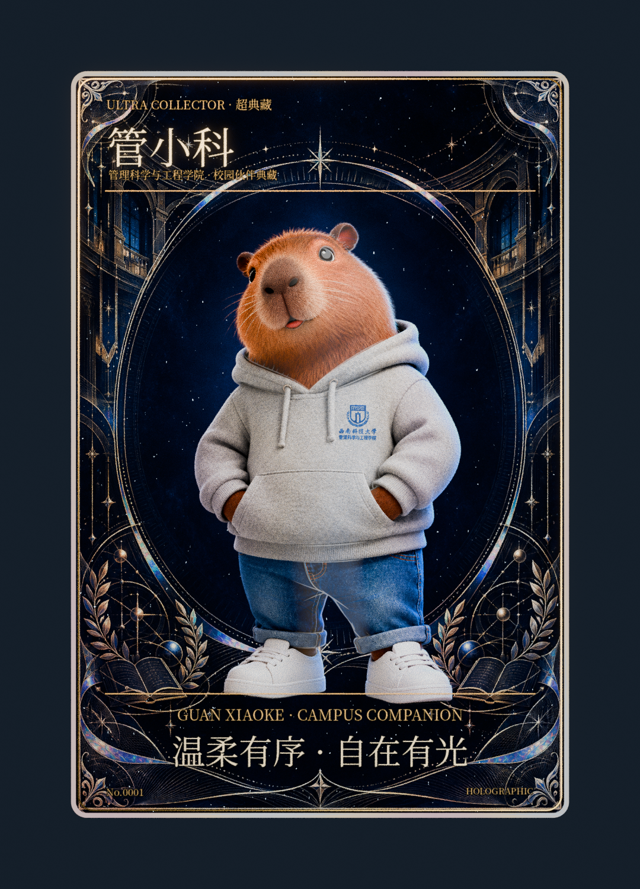

# 管小科 · No.0001 · 超典藏收藏卡

学院蓝与精细金属雕纹，保留管小科温和、自信、俏皮的校园伙伴气质。支持翻面、拖动视差、镭射反光、自动摆动和图片保存。

- [下载单文件互动卡](https://github.com/xumiao567/GPT-skill/raw/refs/heads/guan-xiaoke-no0001/cards/guan-xiaoke-no0001/index.html)：保存为 HTML 文件，再用电脑上的 Chrome 或 Edge 打开。图片、模型及运行依赖已内嵌。
- [下载完整工程 ZIP](https://github.com/xumiao567/GPT-skill/raw/refs/heads/guan-xiaoke-no0001/cards/guan-xiaoke-no0001/project.zip)：包含原始图片、可编辑 Blender 工程、渲染图和网页源码。
- [查看高清卡面](preview.png)。

操作：拖动卡片查看反光，FLIP 翻面，FRONT 返回正面，AUTO 自动摆动，RESET 复位，SAVE 保存图片，FOIL 调节镭射强度。

已在 Chromium 中验证两种交付版本的模型和素材加载、拖动、翻面与返回、滑杆、自动摆动与复位、图片保存和 390px 窄屏布局，没有控制台错误。测试通过本地 HTTP 服务执行；当前云浏览器限制直接打开 file://，因此未在该环境中验证双击本地文件。实体触屏设备未测试。

GitHub 文件预览不会运行互动卡的脚本；请先下载 HTML，或自行启用 GitHub Pages 后以网页访问。本分支没有启用 Pages。

作品使用 [EverettFish/holo-card-studio](https://github.com/EverettFish/holo-card-studio) 制作，底层技能和依赖的许可证包含在完整工程中。
