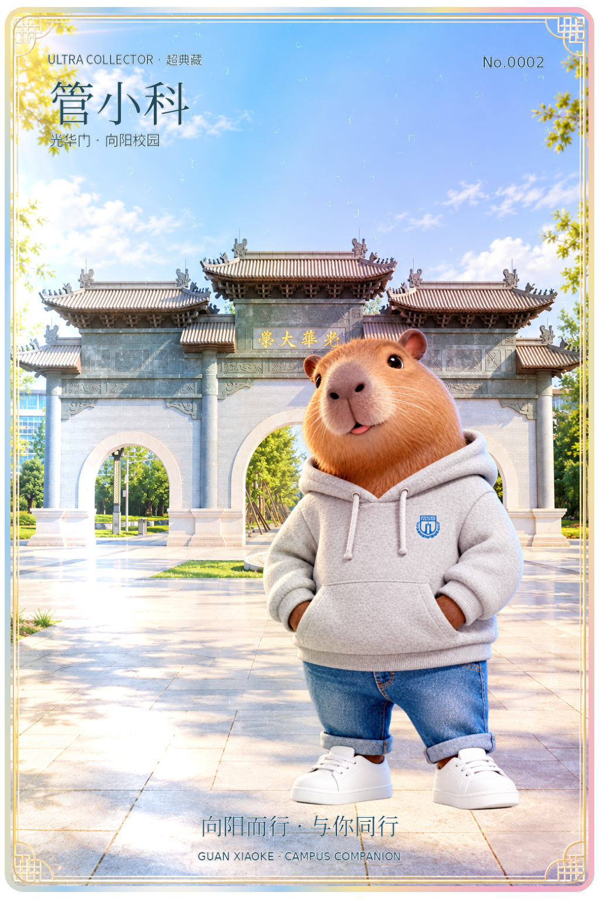
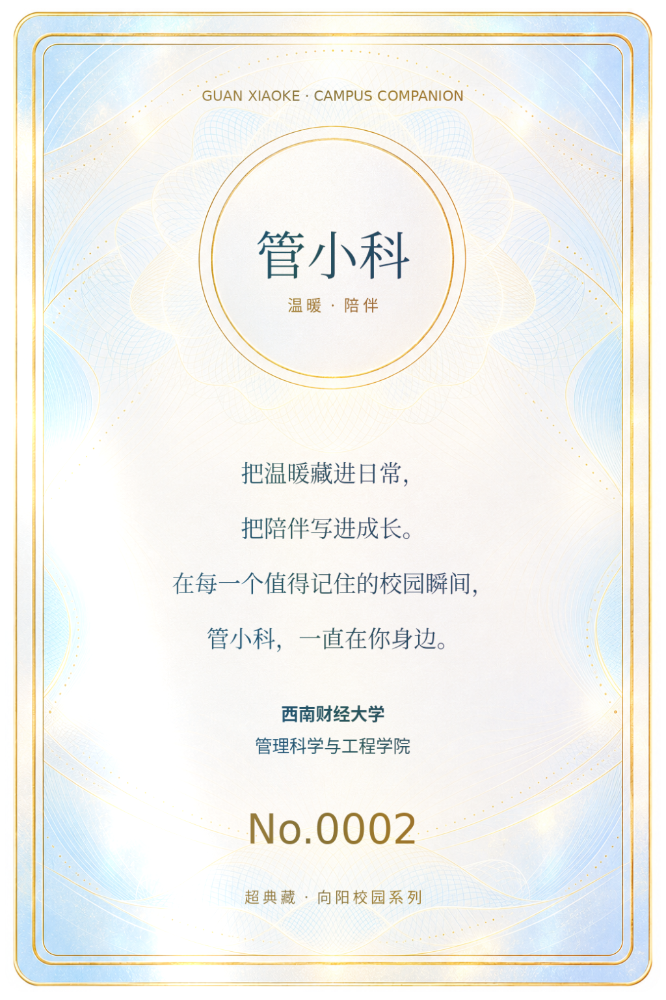

# 管小科 · No.0002 · 光华门向阳校园超典藏

光华门背景，浅蓝、暖白与香槟金色调，青年大学生的阳光与自信。支持翻面、触摸/鼠标拖动、视差、动态镭射光、自动摆动和图片保存。

## 下载

- **[下载完整工程 ZIP](https://github.com/xumiao567/GPT-skill/raw/refs/heads/guan-xiaoke-no0002/cards/guan-xiaoke-no0002/project.zip)**：解压后，用电脑上的 Chrome 或 Edge 打开「管小科-No.0002-互动收藏卡.html」。含原始图层、Blender 工程、渲染图和网页源码。
- [下载单文件互动 HTML](https://github.com/xumiao567/GPT-skill/raw/refs/heads/guan-xiaoke-no0002/cards/guan-xiaoke-no0002/index.html)：若浏览器显示源码，可另存为 HTML；图片、模型和运行依赖全部内嵌。
- [下载正面高清 PNG](https://github.com/xumiao567/GPT-skill/raw/refs/heads/guan-xiaoke-no0002/cards/guan-xiaoke-no0002/preview.png)
- [下载背面高清 PNG](https://github.com/xumiao567/GPT-skill/raw/refs/heads/guan-xiaoke-no0002/cards/guan-xiaoke-no0002/back.png)

GitHub 文件预览不会运行互动脚本。本次为仓库文件交付，没有启用 GitHub Pages。手机上的动态效果需要使用支持 WebGL 的浏览器，建议通过静态网站访问；微信或系统文件预览可能无法运行 HTML。

## 正面

## 背面

背面参照用户提供的姓名圆框、双线金属边框和陪伴寄语布局，改为浅色珍珠底。学校名按用户确认使用「西南财经大学」，编号更新为 No.0002。

> 把温暖藏进日常，
> 把陪伴写进成长。
> 在每一个值得记住的校园瞬间，
> 管小科，一直在你身边。

## 使用与验证

拖动观察镭射光；「翻面」切换背面；「自动摆动」观察连续反光；「保存图片」导出当前角度。正反面使用相同编号。

已验证源码网页和单文件网页的 GLB/素材加载、拖动、翻面/返回、镭射滑杆、自动/复位、图片保存、390px 窄屏无横向溢出，以及模拟手机触摸拖动与按钮翻面，没有控制台错误。实体手机未实测。云浏览器策略限制 file:// 导航，单文件通过本地 HTTP 测试；本地双击打开未在云环境中验证。

光华门和角色画作由用户参考图经图像生成适配，姓名、学校和编号用字体精确排版。网页与 Blender 的色彩和灯光有所差异。

作品使用 [EverettFish/holo-card-studio](https://github.com/EverettFish/holo-card-studio) 制作，技能与 Three.js 许可证包含在工程中。
